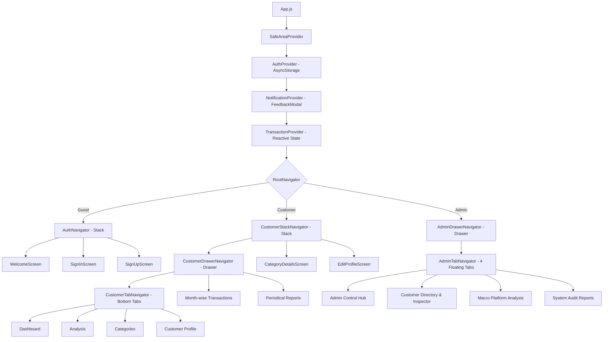

# ⚡ FinPulse — Smart Budget & Wealth Intelligence Engine

[](https://reactnative.dev/)
[](https://expo.dev/)
[](https://react.dev/)
[](https://developer.mozilla.org/)
[](https://react-native-async-storage.github.io/async-storage/)
[](LICENSE)

> **FinPulse** is a modern, high-performance personal finance management and administrative wealth intelligence mobile application built with **React Native**, **Expo (SDK 58)**, and **JavaScript**.

---

## 📱 Product Overview

FinPulse bridges the gap between basic expense recorders and full-fledged autonomous financial assistants. Built with a bespoke **Royal Sapphire Blue (`#1E40AF`)** and **Electric Ocean Azure (`#0284C7`)** design system, it delivers an intuitive, glassmorphic UI paired with powerful financial algorithms.

The platform provides complete role-based segregation:
- **Customers** manage personal cash flow, set digital savings milestones, analyze 50/30/20 budget compliance, and track month-wise expenses.
- **Administrators** monitor system-wide aggregate volumes, inspect customer expense portfolios in real time, and view platform-wide macro analytics.

---

## ✨ Key Features

### 1. 🧠 50/30/20 Financial Health & Wealth Advisor
- **Algorithmic Scoring (0 – 100)**: Evaluates live spending discipline, savings surplus, and budget health.
- **50/30/20 Rule Breakdown**:
  - **Needs (≤ 50%)**: Rent, utilities, food, and essentials.
  - **Wants (≤ 30%)**: Shopping, leisure, dining, and subscriptions.
  - **Savings (≥ 20%)**: Retained net surplus.
- **Safe Daily Allowance**: Calculates daily burn-rate limit based on remaining billing cycle days.
- **Actionable AI Recommendations**: Tailored cost-cutting insights based on real-time transaction activity.

### 2. 🎯 Smart Savings Vault (Milestone Goals)
- Create target pots with custom goals (*Emergency Fund*, *Tech Upgrade*, *Vacation & Travel*).
- Interactive quick-deposit pills (`+₹500`, `+₹1,000`, `+₹2,000`, `+₹5,000` or custom amounts).
- Real-time progress bars and milestone completion badges (*🎉 Target Achieved!*).

### 3. 👥 Dedicated Admin Control Hub & Customer Inspector
- **Platform Financial Summary**: Real-time aggregate net volume, platform inflow, and outflow across all active users.
- **Customer Directory & Inspector**: Search through registered customers and tap into an individual customer's expense breakdown, category allocations, and historical ledger.
- **Macro Analysis with Customer Filter Pills**: Dynamic selector (`[All Platform] [Priya Sharma] [Kishore Kumar] [Anita Roy]`) allowing instant metric re-computation for any individual customer or platform-wide.
- **Strict Read-Only Admin Security**: Administrative credentials are protected, keeping personal profile editing customer-exclusive.

### 4. 📅 Month-Wise Ledger & Smart Transactions
- Horizontal calendar month selector (Jan – Dec 2026) with dynamic year switching.
- Add Transaction modal with income/expense segmented toggles, category tagging, date pickers, and notes.
- Quick search and instant swipe/delete actions with confirmation prompts.

### 5. 🏷️ Overall Categories & Dynamic Category Details
- 10 core financial categories with custom icons and color schemes.
- Visual spending progress bars for every category against historical averages.
- Tapping any category opens a dedicated details screen filtering transactions and calculating totals for that specific category.

### 6. 📊 Periodical Financial Reports
- **Daily View**: Granular transaction breakdown for the current 24-hour cycle.
- **Weekly View**: 7-day rolling financial performance and net cash flow.
- **Monthly View**: Comprehensive 30-day overview with category-wise spending ranking.

### 7. 👤 Customer Profile & Avatar Preset Engine
- Interactive avatar picker with curated illustrated presets.
- Dynamic network image loading with graceful offline initials fallback.
- Customer-only profile editing (name, email, phone, occupation, avatar).

### 8. 🚫 Zero-Alert In-App Feedback System (`FeedbackModal.js`)
- Replaces dated OS-native alert dialogs with sleek, branded micro-modals.
- Contextual personalized messages: `"Hi [Name], your transaction has been added successfully."`
- Seamless callback navigation chaining.

---

## 🏗️ Architecture & Navigation Hierarchy



---

## 📂 Project Structure

```
REACT-NATIVE-HACK/
├── assets/                       # Custom adaptive icons and branding assets
├── src/
│   ├── components/
│   │   ├── AddTransactionModal.js # Transaction entry modal with validation
│   │   ├── CategoryCard.js        # Category tile with budget progress bar
│   │   ├── CustomButton.js        # Button components (Primary, Outline, Danger)
│   │   ├── CustomInput.js         # Input field with labels & secure text toggle
│   │   ├── EmptyState.js          # Engaging zero-state illustration
│   │   ├── FeedbackModal.js       # Minimalist in-app confirmation modal
│   │   ├── FinancialHealthModal.js# 50/30/20 Wealth intelligence advisor
│   │   ├── Header.js              # Polymorphic header with drawer/back actions
│   │   ├── SavingsGoalsSection.js # Digital piggy bank & savings vault
│   │   ├── SummaryCard.js         # Hero financial gradient card
│   │   ├── TransactionCard.js     # Transaction item with delete confirmation
│   │   └── UserAvatar.js          # Curated avatar presets with fallback
│   ├── context/
│   │   ├── AuthContext.js         # Session persistence & user database
│   │   ├── NotificationContext.js # Centralized modal toast manager
│   │   └── TransactionContext.js  # Ledger state, calculations & filters
│   ├── data/
│   │   └── demoData.js            # Initial demo users & realistic transactions
│   ├── navigation/
│   │   ├── AdminDrawerNavigator.js# Admin administrative drawer
│   │   ├── AdminTabNavigator.js   # Admin 4-tab floating bottom bar
│   │   ├── AuthNavigator.js       # Authentication stack
│   │   ├── CustomDrawerContent.js # Custom drawer profile header & menu
│   │   ├── CustomerDrawerNavigator.js # Customer drawer
│   │   ├── CustomerStackNavigator.js  # Customer stack (modals & details)
│   │   ├── CustomerTabNavigator.js    # Customer floating bottom bar
│   │   └── RootNavigator.js       # Authentication gatekeeper
│   ├── screens/
│   │   ├── admin/
│   │   │   ├── AdminCustomersScreen.js # Searchable customer inspector
│   │   │   └── AdminDashboardScreen.js # Platform volume & audit hub
│   │   ├── auth/
│   │   │   ├── SignInScreen.js    # Quick-login pills & role validation
│   │   │   ├── SignUpScreen.js    # Customer onboarding
│   │   │   └── WelcomeScreen.js   # Fintech hero landing screen
│   │   └── customer/
│   │       ├── AnalysisScreen.js        # 50/30/20 ratios & customer pills
│   │       ├── CategoriesScreen.js      # Overall category management
│   │       ├── CategoryDetailsScreen.js # Category-scoped historical records
│   │       ├── CustomerDashboardScreen.js# Hero metrics, vault & health score
│   │       ├── EditProfileScreen.js     # Customer profile & avatar picker
│   │       ├── ProfileScreen.js         # Customer profile overview
│   │       ├── ReportsScreen.js         # Daily / Weekly / Monthly aggregation
│   │       └── TransactionsScreen.js    # Calendar month-wise ledger
│   ├── theme/
│   │   ├── colors.js              # Royal Sapphire, Azure & Ice Blue tokens
│   │   └── spacing.js             # 4pt grid system, border radii & shadows
│   └── utils/
│       ├── calculations.js        # Financial math, 50/30/20 rule, savings rates
│       ├── currency.js            # Indian Rupee (₹) formatting standards
│       ├── dates.js               # Date helpers & period filters
│       └── validation.js          # Form validators & sanitizers
├── App.js                         # Application entrypoint & Provider hierarchy
├── app.json                       # Expo application manifest
├── LICENSE                        # MIT License
└── package.json                   # Dependencies (Expo SDK 58 & React 19)
```

---

## 👥 Demo Accounts

| Role | Name | Email | Password | Primary Permissions |
| :--- | :--- | :--- | :--- | :--- |
| **Customer** | Priya Sharma | `customer@example.com` | `customer123` | Personal Dashboard, Ledger, Categories, Vault, Profile Edit |
| **Customer** | Kishore Kumar | `kishore@example.com` | `customer123` | Personal Portfolio, Budget Tracking, Savings Goals |
| **Customer** | Anita Roy | `anita@example.com` | `customer123` | Personal Ledger, Periodical Reports |
| **Admin** | Admin Supervisor | `admin@example.com` | `admin123` | Platform Hub, Customer Directory & Inspector, Macro Analysis, System Reports |

> **Single-Tap Sign In**: The Sign-In screen includes demo quick-fill buttons (`[Customer]` and `[Admin]`) to populate credentials instantly.

---

## 🛠️ Getting Started

### Prerequisites
- [Node.js](https://nodejs.org/) (v18.0.0 or higher recommended)
- [Expo Go](https://expo.dev/go) app installed on your physical mobile device, or an Android/iOS emulator

### Installation & Run

```bash
# 1. Clone the repository
git clone https://github.com/gokul479/Fin-Pulse.git
cd Fin-Pulse

# 2. Install dependencies (SDK 58 compatible)
npx expo install

# 3. Start the development server
npx expo start
```

Scan the QR code displayed in your terminal using the **Expo Go** application (Android) or the **Camera app** (iOS) to launch the app instantly.

---

## 📄 License

This project is licensed under the terms of the [MIT License](LICENSE).  
Copyright © 2026 FinPulse Systems — Mobile Fintech & Budget Tracking Engineering Team. All rights reserved.
